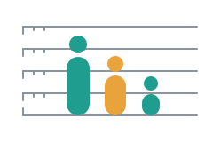

  

<h1 align="center">Lineup</h1>

A character viewer, built on your PC from your own copy.

  <a href="#what-you-can-do">What you can do</a> ·
  <a href="#status">Status</a> ·
  <a href="#platforms">Platforms</a> ·
  <a href="#how-to-use">How to use</a> ·
  <a href="#how-it-works">How it works</a> ·
  <a href="#want-to-help">Want to help?</a> ·
  <a href="#credits">Credits</a> ·
  <a href="#license">License</a>

Lineup reads the game files that are already on your disk, builds indexes and databases from them in a work folder
on your PC, and opens a local web page where you can look at the game's characters: protagonists, story characters,
NPC archetypes, and their clothing, hair, outfits, textures, skeletons and animations. It runs in Python and in your
web browser, and nothing is sent anywhere.

> [!IMPORTANT]
> This repository does not contain the game, keys or an executable, and it does not explain how to get them. You
> need your own copy of the game with its files already readable on disk. Nothing here decrypts or works around any
> protection. Everything Lineup builds (indexes, databases, decoded models and textures) comes from your game,
> stays on your PC in the work folder, and must never be shared.

## What you can do

- Browse **protagonists, story characters and NPC ped archetypes**, and their **clothing and accessories**, in a
  searchable list (three categories, with sub-categories).
- Look at a character in a **textured 3D view** with its levels of detail, textures at full or reduced size,
  wireframe, bounds and studio lighting.
- Show the **skeleton** and **play animations**: clips matched to the character's skeleton, parametric blendspaces
  and motion matching databases.
- Open the character's **in-game outfits**, dress it from the **wardrobe**, and pick **clothing material variants
  and tints**.
- See **hair, beards, brows and lashes**, including **strand grooms**, with a 48-colour hair palette read from your
  copy, and a page that browses all 5,751 strand grooms.
- Add **tattoos and make-up overlays**.
- **Export** a model as a glTF binary (`.glb`) for your own use: raw geometry, textured, rigged, or animated.

## Status

Measured on one copy of game version 1.0.2.1, on one Windows 11 PC. "Tested" means we ran it; the automated checks
are in `tests/` (see [How it works](#how-it-works)).

| What | Status |
|---|---|
| Finding the game and checking its version | Works; tested (a wrong folder and a wrong version give a clear message). |
| The build (8 stages) | Works; tested from an empty work folder, about 15 minutes on the author's PC, 0.9 GB. A second run skips everything. |
| Character list | Works; tested. 7,949 items: 117 protagonist items, 5,274 characters, 2,558 clothing and accessories (23,377 model resources). |
| Textured 3D view, levels of detail | Works; tested (four characters and a clothing item loaded in a real browser with no console errors). 88.6% of the texture slots of these items resolve to a texture in your copy; the rest show as "not in local packs". |
| Skeleton and animation playback | Works; one clip played in a browser without errors. 68,716 clip dictionaries and 418,124 clips are indexed. Other clips and blendspaces were only checked through the API. |
| Outfits, wardrobe, tints, tattoos and overlays | The data routes were tested. The panels were opened but not exercised one by one. |
| Strand hair | Approximate unless you supply shader listings of your own ([docs/strand-shaders.md](docs/strand-shaders.md)). The grooms page renders. |
| Export to `.glb` | The raw geometry route was tested. The textured, rigged and animated export buttons were not run. |
| Texture decoding | Works. Some textures use BCPack entries that are not fully confirmed and may show small errors ([docs/bcpack.md](docs/bcpack.md)). An optional C helper makes BCPack textures about 6 to 15 times faster. |
| World placements, maps, vehicles, weapons | Not included. Lineup reads only the character data. |
| Other game versions | Not supported. Lineup finds data by its position in the files of version 1.0.2.1 and stops on anything else. |

## Platforms

| Platform | Status |
|---|---|
| Windows 11 | Tested with Python 3.14. |
| Windows 10 | Expected to work (same code); not run. |
| Linux | The unit tests and the optional C build pass in CI (GitHub's Ubuntu runner). The full build and the viewer have **not been run** against a game copy. Also untested: the search for the game folder on a real machine, the folder dialog, `launch.sh`. |
| macOS | The same: unit tests and the C build pass in CI (GitHub's macOS runner); the full build and the viewer have **not been run**. `Launch.command` is untested. |

Python 3.10 is the lowest supported version: the unit tests pass on 3.10 and on the newest Python in CI, on all three
platforms. The full build and the viewer have only been run with Python 3.14.

## How to use

### The easy way

1. Install **Python 3.10 or newer** from <https://www.python.org/downloads/>. On Windows, tick "Add python.exe to
   PATH" (or install the `py` launcher).
2. Download this repository (the green Code button, then Download ZIP) and unzip it anywhere.
3. Double-click **`Launch.bat`** on Windows, run **`./launch.sh`** in a terminal on Linux, or double-click
   **`Launch.command`** on macOS.

The first run creates a private Python environment in a `.venv` folder next to the files and installs numpy and
Pillow into it (this needs an internet connection once). Then Lineup looks for your game, checks it, builds what is
missing and opens your browser at `http://127.0.0.1:8910`. Later runs start in seconds.

**How it finds your copy.** A game folder is the one that holds `MicrosoftGame.Config` and `packs.rpf`, next to
`data.rpf`, `common.rpf`, `anim.rpf`, a `pack` folder and a `data` folder, all as plain files. Lineup looks two
folders deep in Downloads, Desktop, Documents, Games, your home folder and the top of every drive (Windows),
`/Volumes` (macOS) or `/mnt`, `/media/<you>` and `/run/media/<you>` (Linux). If it finds several it asks which; if it
finds none it asks you to paste the path. It never reads large files while searching.

**What you need**

- Your own copy of the game, **version 1.0.2.1**, with its files readable on disk. Other versions are refused.
- About **3 GB free** for the work folder (0.9 GB built, the rest is room for the cache that grows as you browse).
- Python 3.10 or newer; numpy and Pillow (the launchers install them for you).
- Optional: a C compiler (Visual Studio Build Tools on Windows, `gcc` or `clang` elsewhere) for faster texture
  decoding. Without one Lineup says so once and carries on.

**How long the first build takes.** About 15 minutes on the author's PC, with the game's archives already in the
operating system's file cache (the first stage, which reads about 30 GB, took 3 to 7 minutes). That is one machine;
reading the archives for the first time from a slow disk will take longer. Nothing was measured on other hardware.

### From a terminal

    python lineup.py                        find the game, check it, build what is missing, open the viewer
    python lineup.py --game PATH [--work PATH]
    python lineup.py --find                 list copies found on this machine
    python lineup.py --pick                 choose the game folder in a folder dialog (tkinter, optional)
    python lineup.py --check                check the copy, build nothing
    python lineup.py --build                build only, do not open the viewer
    python lineup.py --stages index,drawables
    python lineup.py --rebuild [stage,...]  force stages to run again
    python lineup.py --status               what is built, how big the work folder is
    python lineup.py --port N --no-browser
    python lineup.py --force                continue despite a version mismatch

`--stages` limits the build to those stages (and what they need) and `--rebuild` forces stages to run again; add
`--build` to stop before the viewer starts. The launchers pass their arguments on, for example
`Launch.bat --game "D:\Games\GTAVI"`. Problems and fixes are in
[docs/troubleshooting.md](docs/troubleshooting.md).

## How it works

| Piece | What it does | Where |
|---|---|---|
| Finder and version check | Finds the game folder; checks `MicrosoftGame.Config` and four file sizes | `engine/gamefinder.py` |
| The three places | Game (read only), work (everything built), engine (the code) | `engine/paths.py` |
| Build runner | Runs the stages in order, with receipts so finished stages are skipped | `engine/build.py` |
| Indexes | Finds the zlib streams, metadata (PSO) and XML members in each archive | `engine/archive_index.py`, `rpf9_psin.py`, `decode_pso.py` |
| Names | Learns names for hashes from your own files | `engine/names.py` |
| Models and rigs | Model resources, skeletons, skinning, helper bones | `engine/model_decode.py`, `drawables.py`, `character_rig.py` |
| Textures | Texture packs and the BCPack codec, with optional C helpers | `engine/ttpf_format.py`, `bcpack.py`, `native_build.py` |
| Character data | Archetypes, outfits, clothing presets, faces, hair, tattoos, animation | `engine/ped_archetypes.py`, `char_outfits.py`, `clothing_presets.py`, `char_groom.py`, `anim_service.py` |
| Server | A small web server on `127.0.0.1` | `engine/server.py`, `model_service.py`, `groom_service.py` |
| Viewer | The page you see: WebGL in your browser, no outside requests | `viewer/` |

More in [docs/how-it-works.md](docs/how-it-works.md), [docs/formats.md](docs/formats.md),
[docs/names.md](docs/names.md), [docs/bcpack.md](docs/bcpack.md) and
[docs/strand-shaders.md](docs/strand-shaders.md).

## Want to help?

Read [CONTRIBUTING.md](CONTRIBUTING.md). One rule above all: **never attach game files, extracted assets,
screenshots of extracted assets or generated databases to an issue or a pull request.**

## Credits

Lineup's code, decoders and research are this project's own work. The repository layout and the "built from your own
copy" approach follow the Leonida project (<https://github.com/ItsNotRexed/Leonida>).

Grand Theft Auto and all related names are trademarks of their owners. This project is not affiliated with or endorsed by them.

## License

GPLv3 (or any later version). See [LICENSE](LICENSE).
